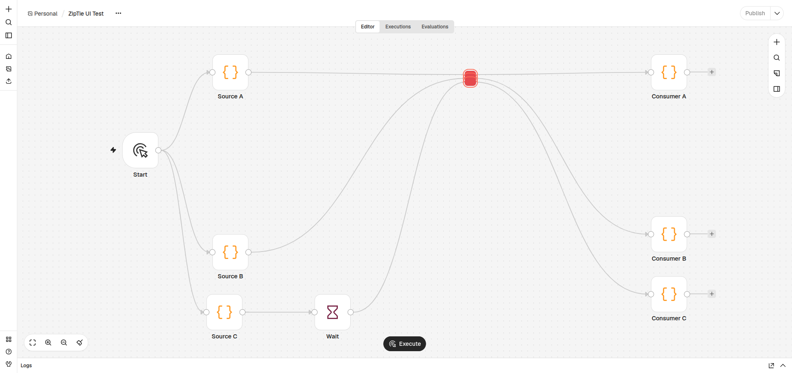
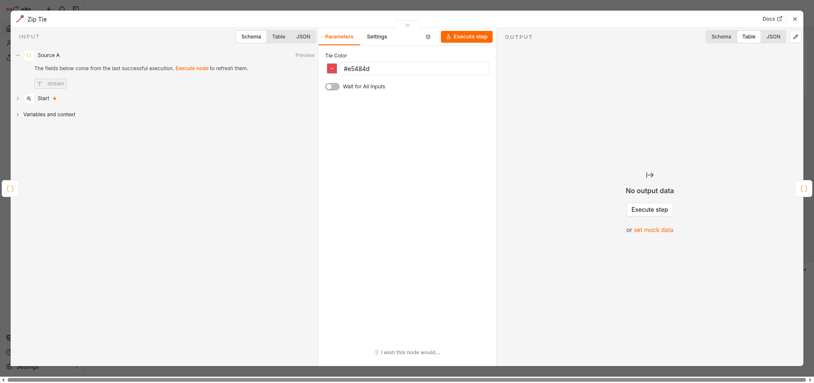
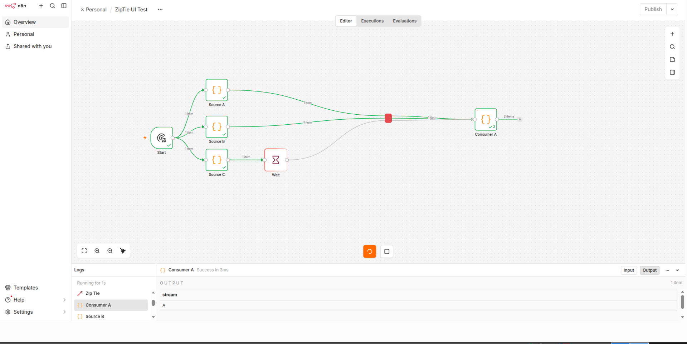

# Zip Ties for n8n

Turn a bundle of connections into a compact, colour-coded **Zip Tie**. Hold **X** and drag across several wires: every crossed connection gets its own single-pair pass-through node, visually grouped into one small block. The original sources and targets stay connected.

> **Beta `0.4.0-beta.4`**  
> Tested with self-hosted **n8n 2.44.7** and **2.46.0** on Node.js **24+**. The editor overlay reads n8n internals and must be checked after n8n upgrades. n8n Cloud is not supported because it does not expose `EXTERNAL_FRONTEND_HOOKS_URLS`.

> **Non-standard distribution model:** This is not a regular community node package. The backend node follows n8n package conventions, but the compact canvas UI is injected through the self-hosted `EXTERNAL_FRONTEND_HOOKS_URLS` hook and manipulates n8n's editor internals. It is not an official n8n plugin API, is not available on n8n Cloud, and is not a candidate for the verified community node catalogue. Installing only the node package gives you a working pass-through node without the compact overlay.



The editor overlay provides the compact look: no icon, labels, handles or incoming arrowheads. **Double-click** a compact tie to open its settings and change **Tie Color**. `Ctrl+Alt` still switches the whole custom layer off when you need the full native node.



Execution is 1:1: input `i` is passed to output `i`. Data is never merged, so items, binary data and `pairedItem` stay on their original branch.

Because every crossed edge runs on its own pair node, a slow branch does not hold up the others. In the screenshot, **Consumer A** has already completed while the **Wait** branch is still running.



## Demo

A 12-second example: X-drag creates the compact ties, then the workflow executes without waiting for the slow branch.

<video src="docs/demo.mp4" poster="docs/demo-poster.jpg" controls muted loop playsinline width="100%"></video>

If the video does not play inline, [open `docs/demo.mp4` directly](docs/demo.mp4).

## What you get


- **X-drag** across main wires creates one visual tie group with one single-pair node per crossed connection.
- Independent execution: a slow branch does not block other branches.
- Pair nodes in one group are staggered by **10 px** so their outgoing edges do not converge.
- **Double-click** opens the node settings without leaving compact mode.
- **Tie Color** changes the compact block colour.
- **Ctrl+Alt** toggles the custom CSS/JS layer.
- **Ctrl+C / Ctrl+V** copies and pastes a complete tie group as one unit.
- **Ctrl+Z** removes the most recent tie insertion or pasted group.
- Ties are ordinary n8n nodes and are saved with the workflow.
- New nodes are single-pair; ports are placed automatically: inputs use the majority side, outputs use the opposite side.
- **Pairs** and **Port Layout** are not shown in the node settings anymore. **Wait for All Inputs** remains for legacy multi-pair nodes.

## Non-standard approach

A normal n8n community node is a server-side npm package with a standard parameter UI. You install it from **Settings → Community nodes** and restart n8n. There is no external JavaScript, no static host and no editor DOM manipulation.

Zip Ties splits into two parts:

- the **node package** — a normal `n8n-nodes-*` package with a `dist/` build and standard n8n metadata;
- the **overlay** — a separate `zip-ties-frontend.js` + `zip-ties.css` loaded by `EXTERNAL_FRONTEND_HOOKS_URLS`.

The overlay is a self-hosted customization, not part of the community node contract. It requires administrator access, a pinned frontend URL and a restart of n8n. It reads `#app.__vue_app__`, Pinia stores and Vue Flow DOM attributes, so it may need changes after an n8n upgrade. This is why the project is distributed as a beta for self-hosted power users rather than as a regular verified community node.

If you install only the npm package and skip the frontend hook, the node still executes correctly as a pass-through, but compact blocks, X-drag, group copy/paste and Tie Color are not available.

## Requirements

- Self-hosted n8n **2.44.7** or **2.46.0** (other versions are not tested).
- Node.js **24+**.
- Ability to set `EXTERNAL_FRONTEND_HOOKS_URLS` on the n8n server.
- A static HTTPS location for `zip-ties-frontend.js` and `zip-ties.css`, reachable from every browser that opens n8n.
- Community nodes enabled if you install through the n8n UI.
- Docker is only required for the example stack and the E2E tests.

## Install

There are three parts: install the node package, host the frontend files, and tell n8n where the frontend script is.

### 1. Install the node package

The beta is published on npm as `0.4.0-beta.4` under the `beta` tag.

For a normal n8n installation:

```sh
cd ~/.n8n/nodes
npm install n8n-nodes-zip-tie@0.4.0-beta.4
```

You can also install `n8n-nodes-zip-tie@beta` to follow the beta tag. The `latest` tag also points at the current beta until a stable release is published.

For Docker, install into the correct n8n user folder:

```sh
N8N_CONTAINER=n8n-n8n-1

docker exec "$N8N_CONTAINER" sh -lc '
  set -e
  ROOT="${N8N_USER_FOLDER:-/home/node/.n8n}"
  if [ -d "$ROOT/.n8n" ]; then ROOT="$ROOT/.n8n"; fi
  cd "$ROOT/nodes"
  npm install n8n-nodes-zip-tie@0.4.0-beta.4
'
docker restart "$N8N_CONTAINER"
```

The package is installed when this directory exists and contains `dist/nodes/ZipTie/ZipTie.node.js`:

```text
<user-folder>/nodes/node_modules/n8n-nodes-zip-tie/
```

The same package is available from **Settings → Community nodes → Install**. Use `n8n-nodes-zip-tie` (latest) or the exact beta version. n8n Cloud only accepts verified community nodes, and this package is not verified.

#### Local tarball for offline/development installs

From the repository:

```sh
npm install
npm run build
npm pack
```

That creates `n8n-nodes-zip-tie-0.4.0-beta.4.tgz`. Install it into n8n:

```sh
docker cp "$PWD/n8n-nodes-zip-tie-0.4.0-beta.4.tgz" \
  "$N8N_CONTAINER:/tmp/n8n-nodes-zip-tie.tgz"

docker exec "$N8N_CONTAINER" sh -lc '
  set -e
  ROOT="${N8N_USER_FOLDER:-/home/node/.n8n}"
  if [ -d "$ROOT/.n8n" ]; then ROOT="$ROOT/.n8n"; fi
  cd "$ROOT/nodes"
  npm install /tmp/n8n-nodes-zip-tie.tgz --omit=dev
'
docker restart "$N8N_CONTAINER"
```

For a non-Docker installation:

```sh
cd ~/.n8n/nodes
npm install /path/to/n8n-nodes-zip-tie-0.4.0-beta.4.tgz --omit=dev
```

Then restart n8n.

### 2. Host the frontend files

Serve the `frontend/` directory from any static web server:

- `zip-ties-frontend.js` — the overlay;
- `zip-ties.css` — the compact styles;
- `nginx.conf` — a minimal nginx example.

The browser loads the CSS **relative to the script URL**, so both files must be in the same directory.

For a quick local server:

```sh
docker run -d --name zip-ties-ui -p 8099:80 \
  -v "$PWD/frontend:/usr/share/nginx/html:ro" \
  -v "$PWD/frontend/nginx.conf:/etc/nginx/conf.d/default.conf:ro" \
  nginx:alpine
```

For a shared installation:

- use HTTPS;
- use the exact versioned URL;
- do not point users at a mutable `latest` URL;
- make sure the n8n page and the frontend have the same scheme (both HTTPS, or both HTTP).

Example URL:

```text
https://your-host.example/zip-ties/zip-ties-frontend.js?v=0.4.0-beta.4
```

You do **not** need npm to serve the script from the repository. Use jsDelivr's GitHub endpoint with a tag or commit, not `raw.githubusercontent.com`:

```text
https://cdn.jsdelivr.net/gh/Daniil-Techart/n8n-nodes-zip-tie@v0.4.0-beta.4/frontend/zip-ties-frontend.js
```

Create and push the tag first if it does not exist:

```sh
git tag v0.4.0-beta.4
git push origin v0.4.0-beta.4
```

jsDelivr serves JavaScript and CSS with correct MIME types. `raw.githubusercontent.com` serves `text/plain` with `X-Content-Type-Options: nosniff`, so browsers may refuse the script and stylesheet.

After npm publication, the npm jsDelivr URL is also available:

```text
https://cdn.jsdelivr.net/npm/n8n-nodes-zip-tie@0.4.0-beta.4/frontend/zip-ties-frontend.js
```

### 3. Point n8n at the frontend

Add this environment variable to the n8n service and restart it:

```sh
EXTERNAL_FRONTEND_HOOKS_URLS=https://your-host.example/zip-ties/zip-ties-frontend.js?v=0.4.0-beta.4
```

For Docker Compose:

```yaml
services:
  n8n:
    environment:
      - EXTERNAL_FRONTEND_HOOKS_URLS=https://your-host.example/zip-ties/zip-ties-frontend.js?v=0.4.0-beta.4
```

The URL is loaded by the **browser**, not by the n8n container. Do not use `localhost` when other people open n8n from another computer.

### Docker Compose example

[`examples/docker-compose.yml`](examples/docker-compose.yml) contains a complete local example with n8n and the nginx frontend.

Create a persistent encryption key first:

```sh
printf 'N8N_ENCRYPTION_KEY=%s\n' "$(openssl rand -hex 32)" > .env
```

Then edit `YOUR_HOST` in the example and start it:

```sh
docker compose -f examples/docker-compose.yml up -d
```

The example is for local/LAN HTTP testing. For anything shared or internet-facing, terminate TLS, set `N8N_PROTOCOL=https`, and set `N8N_SECURE_COOKIE=true`.

## Verify the installation

1. Open **Settings → Community nodes** and confirm `n8n-nodes-zip-tie` is listed. If your n8n version requires it, enable unverified packages with `N8N_UNVERIFIED_PACKAGES_ENABLED=true`.
2. Open any workflow. In the browser console, look for:

   ```text
   [zip-ties-ui] Ctrl mode active
   ```

3. Open the Network tab and confirm `zip-ties-frontend.js?v=0.4.0-beta.4` and `zip-ties.css?v=0.4.0-beta.4` return HTTP 200.
4. Hold **X**, drag across a few main connections, and confirm the compact red block appears.
5. Double-click the block and confirm the settings panel opens with **Tie Color**. It should not show **Pairs** or **Port Layout**.
6. Change the colour, close the panel, and confirm the block updates.
7. Save the workflow, reload the page, and confirm the ties are still connected.

If the node appears in the workflow but the settings say “Install this node to use it”, the package was copied to the wrong user folder. Check both `<user-folder>/nodes/...` and `<user-folder>/.n8n/nodes/...`.

## Use

| Action | Gesture |
|---|---|
| Tie wires together | Hold **X**, drag across main connections |
| Open tie settings | **Double-click** the compact tie |
| Change the compact colour | Double-click → **Tie Color** |
| Toggle the custom layer | **Ctrl+Alt** |
| Copy a complete tie group | Select a pair node → **Ctrl+C** |
| Paste a complete tie group | **Ctrl+V** |
| Undo the last tie/paste | **Ctrl+Z** |
| Remove a tie | Native mode → select the pair node → Delete |

The X gesture only intercepts **main** connections. It ignores AI/tool connections and merged/collapsed-group edges.

## How it works

- `nodes/ZipTie/ZipTie.node.js` is a pass-through node. New nodes use one input/output pair; `execute()` returns `getInputData(i)` at output `i`. Legacy `pairs` values remain readable.
- `frontend/zip-ties-frontend.js` is injected into the editor by `EXTERNAL_FRONTEND_HOOKS_URLS`. It samples edge paths, finds the active workflow store, creates one tie node per crossed connection, rewires the connections, and applies the compact visual state.
- Pair nodes in one visual tie share a hidden `zipTieGroup` id. They are laid out with a 10 px vertical stagger.
- Port sides are computed automatically from connected source positions. Outputs are placed on the opposite side.
- Ctrl+C/Ctrl+V use an in-memory group clipboard. Ctrl+Z removes an inserted tie or a pasted group as one action.
- A single pair node copied with the native n8n clipboard is detached from its original group automatically, so it cannot corrupt the source tie.

## Security

`EXTERNAL_FRONTEND_HOOKS_URLS` loads JavaScript with full access to the n8n editor page. Treat the frontend host as part of your n8n trust boundary.

- Use HTTPS and a pinned versioned URL.
- Self-host the frontend or use a pinned CDN path.
- Review frontend changes before changing the URL.
- Do not expose the local/LAN Compose example to the internet.
- Generate `N8N_ENCRYPTION_KEY` with `openssl rand -hex 32`; never commit it.
- Use `N8N_SECURE_COOKIE=true` behind HTTPS.
- Do not install this beta on a shared instance without a backup.

The overlay makes no outbound network requests. It uses `localStorage` only for `zipTies.enabled` and `zipTies.debug`.

## Limitations

- Only n8n **2.44.7** and **2.46.0** are tested. Pin the n8n version and re-check the overlay after upgrades.
- The overlay depends on n8n internals: `#app.__vue_app__`, Pinia stores, Vue Flow classes and `data-test-id` attributes.
- n8n Cloud is not supported.
- The package is not a regular or verified n8n community node; the compact UI is a non-standard self-hosted overlay.
- A visual group is not a native n8n selection. Native selection contains only the top node; the custom group clipboard handles Ctrl+C/V/Z.
- The group clipboard is in memory and is empty after a page reload.
- Deleting one pair node removes the remaining incomplete group and its connections. Use Ctrl+Z immediately if this was accidental.
- The X gesture is a plain `X` shortcut. If another extension uses it, change `event.code !== 'KeyX'` in the frontend.
- The CSS layer uses `!important` to override n8n canvas styles.
- Redo is not implemented.
- The save guard repairs dangling connections in normal `fetch`-based workflow PATCH requests. A future n8n transport change can bypass it; reload before saving if n8n reports an invalid workflow.

## Troubleshooting

### The compact block does not appear

Check the browser console and Network tab for the two frontend files. Verify that `EXTERNAL_FRONTEND_HOOKS_URLS` is set in the running n8n container and that the browser can open the URL directly.

### The tie settings say “Install this node to use it”

The package is in the wrong user folder. Find the actual path:

```sh
docker exec "$N8N_CONTAINER" sh -lc '
  echo "N8N_USER_FOLDER=$N8N_USER_FOLDER"
  find /home/node/.n8n -maxdepth 5 -type d -name n8n-nodes-zip-tie 2>/dev/null
'
```

Reinstall into the folder that contains `nodes/node_modules`, then restart n8n.

### `Workflow structure is invalid ... does not reference an existing node`

Reload the page first, which loads the last saved valid workflow. The overlay sanitizes dangling connections on load, on connection changes, and in normal workflow save requests. If you have unsaved changes, back up the workflow before editing the store manually.

### Ctrl+Alt shows the native node, but double-click does nothing

Confirm that the frontend loaded from the expected versioned URL and reload the page. Double-click detection depends on the n8n canvas DOM structure.

### Mixed content or CSP errors

If n8n is served over HTTPS, the frontend URL must also be HTTPS. Allow the frontend host in the reverse proxy's `script-src` and `style-src` policy if you use a strict CSP.

## Development

```sh
npm ci
npm run build
npm test
npm run lint
npm run lint:syntax
```

`npm run build` copies `nodes/` to `dist/`. `npm pack` and `npm publish` run that build through `prepack`.

### Browser E2E

The E2E suite starts a throwaway n8n instance, installs the built package, creates a workflow through the REST API, and checks the compact ties, double-click settings, group copy/paste and undo in Chromium.

```sh
npx playwright install chromium
npm run e2e
```

Run it against a specific n8n version:

```sh
N8N_VERSION=2.46.0 npm run e2e
```

If ports are busy:

```sh
N8N_PORT=5682 FRONTEND_PORT=8098 npm run e2e
```

Requirements: Docker, Python 3 for the static server, and Chromium via Playwright. CI runs the E2E matrix on n8n **2.44.7** and **2.46.0**.

## Installation instructions for LLM agents

This section is a deterministic brief for an AI/LLM agent installing the beta on a self-hosted n8n host. This is a non-standard two-part installation: the npm node plus the external frontend hook. The agent must ask for missing values instead of guessing.

### Variables the agent needs

```sh
REPO_DIR=/absolute/path/to/n8n-nodes-zip-tie
N8N_CONTAINER=n8n-n8n-1
N8N_VERSION=2.44.7
N8N_HOST_FOR_BROWSER=https://n8n.example.com
FRONTEND_BASE_URL=https://static.example.com/zip-ties
N8N_ENCRYPTION_KEY=<existing persistent key>
```

`N8N_VERSION` must be `2.44.7` or `2.46.0` for this beta. Do not install on n8n Cloud.

### Agent rules

- Do not run `git init`, commit, push, or publish to npm.
- Do not change `N8N_ENCRYPTION_KEY`; reuse the existing value.
- Do not expose n8n or the frontend over plain HTTP on a shared network.
- Do not overwrite a workflow without a backup.
- Stop and report if a version, path, or HTTP check does not match.
- Prefer the tarball install below. Do not use a mutable frontend URL.

### Agent procedure

1. **Preflight**

   ```sh
   node --version
   npm --version
   docker --version
   docker inspect "$N8N_CONTAINER" --format '{{.Config.Image}}'
   docker exec "$N8N_CONTAINER" sh -lc '
     echo "N8N_USER_FOLDER=$N8N_USER_FOLDER"
     echo "N8N_VERSION=$N8N_VERSION"
   '
   ```

   Require Node.js 24+ and n8n 2.44.7/2.46.0. Find the user folder: if `<N8N_USER_FOLDER>/.n8n` exists, the data folder is `<N8N_USER_FOLDER>/.n8n`; otherwise use `<N8N_USER_FOLDER>` (default `/home/node/.n8n`).

2. **Build and pack**

   ```sh
   cd "$REPO_DIR"
   npm ci
   npm run build
   npm test
   npm run lint
   npm pack
   ```

   Require all commands to exit 0. The tarball is `n8n-nodes-zip-tie-0.4.0-beta.4.tgz`.

3. **Install the node in n8n**

   ```sh
   docker cp "$REPO_DIR/n8n-nodes-zip-tie-0.4.0-beta.4.tgz" \
     "$N8N_CONTAINER:/tmp/n8n-nodes-zip-tie.tgz"
   docker exec "$N8N_CONTAINER" sh -lc '
     set -e
     ROOT="${N8N_USER_FOLDER:-/home/node/.n8n}"
     if [ -d "$ROOT/.n8n" ]; then ROOT="$ROOT/.n8n"; fi
     mkdir -p "$ROOT/nodes"
     cd "$ROOT/nodes"
     npm install /tmp/n8n-nodes-zip-tie.tgz --omit=dev
     test -f "$ROOT/nodes/node_modules/n8n-nodes-zip-tie/dist/nodes/ZipTie/ZipTie.node.js"
   '
   docker restart "$N8N_CONTAINER"
   ```

   If the final `test` fails, stop. Do not copy files into an arbitrary folder.

4. **Host the frontend**

   Serve `"$REPO_DIR/frontend"` at `FRONTEND_BASE_URL` with HTTPS. The directory must expose:

   ```text
   /zip-ties-frontend.js
   /zip-ties.css
   ```

   The CSS is loaded relative to the JS URL. Verify:

   ```sh
   curl -fsS -o /dev/null -w '%{http_code}\n' "$FRONTEND_BASE_URL/zip-ties-frontend.js"
   curl -fsS -o /dev/null -w '%{http_code}\n' "$FRONTEND_BASE_URL/zip-ties.css"
   ```

   Both must be `200`.

5. **Configure n8n**

   Set exactly one URL, pinned to the beta version:

   ```sh
   EXTERNAL_FRONTEND_HOOKS_URLS=$FRONTEND_BASE_URL/zip-ties-frontend.js?v=0.4.0-beta.4
   ```

   Add it to the n8n service's environment (Compose, systemd, or the container definition), then recreate/restart n8n. Verify the running process:

   ```sh
   docker exec "$N8N_CONTAINER" sh -lc 'tr "\0" "\n" < /proc/1/environ | grep EXTERNAL_FRONTEND_HOOKS_URLS'
   ```

6. **Browser verification**

   Open `N8N_HOST_FOR_BROWSER` in Chromium with DevTools open and check:

   - console contains `[zip-ties-ui] Ctrl mode active`;
   - Network contains `zip-ties-frontend.js?v=0.4.0-beta.4` and `zip-ties.css?v=0.4.0-beta.4`;
   - a workflow with a tie shows compact red blocks;
   - double-click opens **Tie Color** and does **not** show **Pairs** or **Port Layout**;
   - changing the colour updates the block after closing the panel;
   - `Ctrl+Alt` restores the native node;
   - copy/paste/undo of a tie group works on a test workflow.

7. **Report**

   Return:

   - installed package path;
   - n8n version and container image;
   - frontend URL and local static directory;
   - exact `EXTERNAL_FRONTEND_HOOKS_URLS` value;
   - browser check results;
   - any skipped check and why.

   Do not publish, commit, or expose credentials in the report.

## License

MIT. Maintainer contact: `graf3402@bk.ru`.
